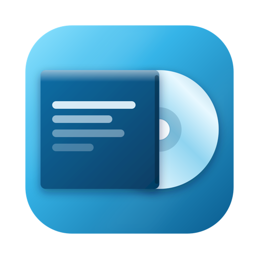
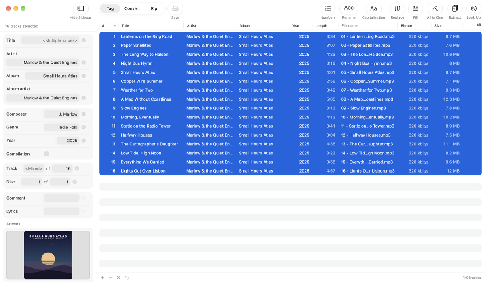
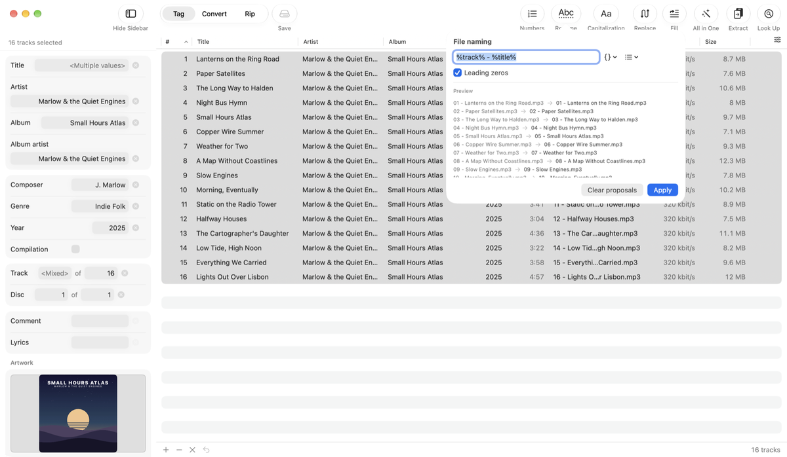
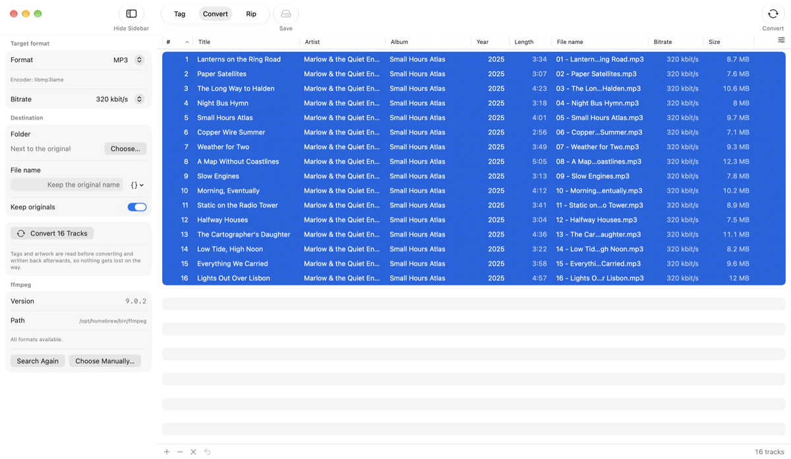
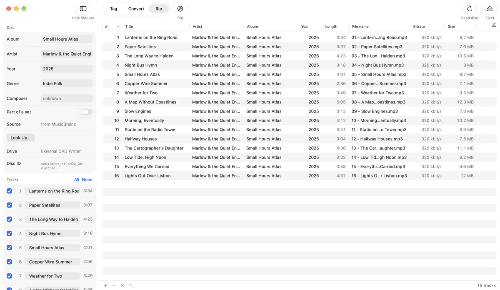
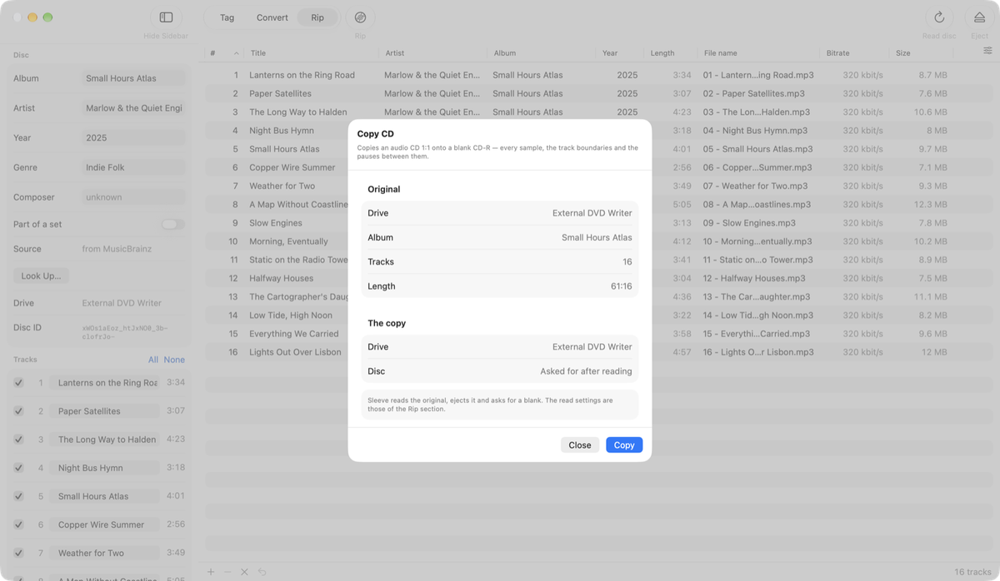
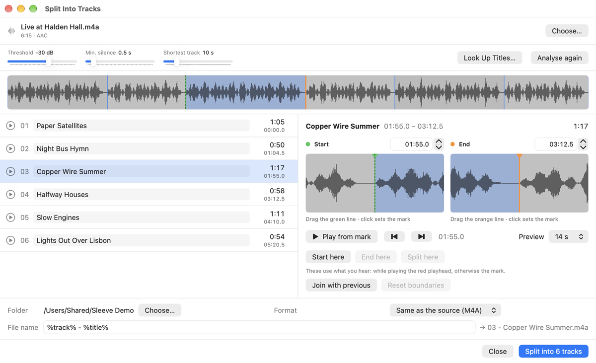

<h1 align="center">Sleeve</h1>

<p align="center">
  
</p>

<p align="center">
  <b>A native macOS audio tagger that also converts, rips and burns CDs, and splits long recordings.</b><br>
  Everything revolves around one track list: ripping produces files, tagging edits them, converting turns them into something else.<br>
  <i>The name comes from the record sleeve: the thing around the music that labels and files it. That is what Sleeve does.</i>
</p>

<p align="center">
  
  
  
  
  
  <a href="../../releases/latest"></a>
</p>

<p align="center">
  <a href="../../releases/latest"></a>
  <a href="https://x.com/NeonRostDEV"></a>
</p>

<p align="center">
  <a href="#features">Features</a> ·
  <a href="#tag">Tag</a> ·
  <a href="#convert">Convert</a> ·
  <a href="#rip">Rip</a> ·
  <a href="#split-into-tracks">Split</a> ·
  <a href="#requirements">Requirements</a> ·
  <a href="#installation">Installation</a> ·
  <a href="#known-limitations">Known limitations</a> ·
  <a href="#support">Support</a> ·
  <a href="https://neonrost.github.io/Sleeve/">Website</a> ·
  <a href="docs/Sleeve-Manual.pdf">Manual (PDF)</a>
</p>

<p align="center">
<picture>
  <source media="(prefers-color-scheme: dark)" srcset="images/screenshot-dark.png">
   for the titles, and the front cover">
</picture>
  <br>
  <sub>The album in the screenshot is made up — artist, titles and cover alike.</sub>
</p>

<table>
  <tr>
    <td width="25%" valign="top">
      <h3>🏷️ One track list</h3>
      Rip a CD, tag what came out, convert it, without importing anything twice.
    </td>
    <td width="25%" valign="top">
      <h3>🔎 MusicBrainz and Discogs</h3>
      Look up the album or the exact pressing, with track lengths side by side before anything is taken over.
    </td>
    <td width="25%" valign="top">
      <h3>💿 Secure ripping</h3>
      Secure mode, read offset, C2 pointers, log and cue sheet, plus gapless disc images and 1:1 copies.
    </td>
    <td width="25%" valign="top">
      <h3>🔒 No account, no tracking</h3>
      Everything runs on your Mac. The network is only used when you look something up.
    </td>
  </tr>
</table>

<br>

## Features

Tag, Convert and Rip share one list of files; splitting long recordings has a window of its own. The album in every screenshot is made up.

<table>
  <tr>
    <td width="50%" valign="top">
      <picture>
        <source media="(prefers-color-scheme: dark)" srcset="images/Sleeve_Tag_dark.png">
        
      </picture>
      <br>
      <sub>Sixteen tracks selected; the inspector shows the shared tags and the cover.</sub>
      <h3>🏷️ Tag</h3>
      One track or a whole album: fields that differ show <code>&lt;Multiple values&gt;</code>, and only fields you touched are written. Numbering, capitalization, find and replace and filling a field from a pattern, every batch step with a preview.
    </td>
    <td width="50%" valign="top">
      <picture>
        <source media="(prefers-color-scheme: dark)" srcset="images/Sleeve_Rename_dark.png">
        
      </picture>
      <br>
      <sub>File naming from a pattern, with a live preview of the new names.</sub>
      <h3>✏️ Rename and look up</h3>
      One pattern syntax in both directions: tags to file names, and file names back to tags. <b>Look Up Album</b> finds the release on MusicBrainz or Discogs and lays its tracks next to your files, lengths included, so a wrong match shows.
    </td>
  </tr>
  <tr>
    <td width="50%" valign="top">
      <picture>
        <source media="(prefers-color-scheme: dark)" srcset="images/Sleeve_Convert_dark.png">
        
      </picture>
      <br>
      <sub>Convert mode, with MP3 at 320 kbit/s chosen for sixteen tracks.</sub>
      <h3>🔄 Convert</h3>
      MP3, AAC, ALAC, FLAC, Opus, Vorbis, WAV and AIFF with ffmpeg. Sleeve reads the tags first and writes them back itself, cover included, so the album artist and the disc number survive the trip.
    </td>
    <td width="50%" valign="top">
      <picture>
        <source media="(prefers-color-scheme: dark)" srcset="images/Sleeve_Rip_dark.png">
        
      </picture>
      <br>
      <sub>Rip mode, with the disc's album, artist and track list in the sidebar.</sub>
      <h3>💿 Rip</h3>
      Reads audio CDs directly, no helper tool: burst or secure mode, a verified read offset, C2 error pointers, an optional second pass, a log and a cue sheet. CD-TEXT, ISRC and the MusicBrainz disc ID fill in the tags.
    </td>
  </tr>
  <tr>
    <td width="50%" valign="top">
      <picture>
        <source media="(prefers-color-scheme: dark)" srcset="images/Sleeve_CopyCD_dark.png">
        
      </picture>
      <br>
      <sub>Copy CD: read, eject, and burn the copy onto a blank in the same drive.</sub>
      <h3>📀 Image, burn, copy</h3>
      From the File menu: a gapless image of the whole disc (BIN, WAV or FLAC plus a cue sheet), burning such an image back to a CD-R, and a one-button 1:1 copy, with one drive or two.
    </td>
    <td width="50%" valign="top">
      <picture>
        <source media="(prefers-color-scheme: dark)" srcset="images/Sleeve_Split_dark.png">
        
      </picture>
      <br>
      <sub>The Track Splitter: waveform, six titled tracks, and the third one's boundaries magnified.</sub>
      <h3>✂️ Split into tracks</h3>
      An album video, a vinyl side or a live set, cut into tracks without re-encoding. Silence detection finds the boundaries, two magnifiers set them exactly, and the titles come from MusicBrainz, Discogs or a pasted track list.
    </td>
  </tr>
</table>

## Tag

- **Batch editor** – drop in files or whole folders, edit in the table or in the inspector. With several tracks selected, fields that differ show `<Multiple values>` instead of an empty box. A field is only written if you actually touched it — an empty-looking field is never written as empty by accident.
- **Numbering** – numbers tracks in their current order, with leading zeros, track totals (03/12) and per-disc or continuous counting.
- **Capitalization** – Title Case with language-aware exceptions ("of", "the", "und", "der" …), UPPER CASE or lower case, for all fields or only chosen ones.
- **Find and replace** – "feat." to "ft.", or remove "(Remastered 2011)" everywhere at once; plain text or regular expressions with `$1`, with a preview of every change before anything happens.
- **Fill a field** – one field from a pattern: album artist from `%artist%`, or the title from the file name with `%filename%`, with a preview.
- **Rename and extract** – one pattern syntax in both directions: `%track% - %artist% - %title%` turns tags into file names with a live preview, and the same pattern read backwards pulls tags out of file names. Missing tags drop their separators too, collisions get ` (2)`.
- **Cover art** – every embedded image with its type (front, back, booklet page, disc …), added by drag and drop, replaced or appended, applied to all selected tracks at once, exported as a file.
- **Look Up Album** – finds the release on **MusicBrainz** (no account needed) or **Discogs** (with your own token) and lays its tracks next to your files, with each file's length against the release's. A file more than 3 s off is marked, so a wrong match shows up even when the titles agree. Pick which fields to take over — the front cover included, in the size you choose; nothing reaches the disk until you save.
- **Undo** – the last save can be undone. **Add to Music** hands the selection to the Music app.

## Convert

Converts to MP3, AAC, ALAC, FLAC, Opus, Vorbis, WAV and AIFF with `ffmpeg` — and writes the tags afterwards itself, cover included. Generic converters tend to lose the album artist or the disc number on the way; Sleeve reads the tags first, keeps ffmpeg's own tag copying switched off, and writes them back with TagLib. File names come from the same pattern engine as renaming.

## Rip

Reads audio CDs directly — no root, no helper tool.

- **Burst or secure mode** – secure reads every block twice, retries on a mismatch and decides by majority. Unresolved spots are named in the log.
- **Read offset**, verified to the byte, **read speed**, **C2 error pointers** where the drive delivers them, and an optional **second pass** that reads every track twice and compares checksums.
- **CD-TEXT, MCN and ISRC**, plus **Look Up…**: the MusicBrainz disc ID finds exactly this pressing; otherwise search MusicBrainz or Discogs by name. The disc's own track lengths sit next to the release's, so a wrong pressing shows before anything is taken over, and on a box set the disc in the drive is picked automatically.
- **Log and cue sheet**, any output format the Convert mode offers (WAV works without ffmpeg), file names from a pattern.

From the File menu:

- **Create Disc Image…** – the whole disc as one continuous audio stream (BIN, WAV or FLAC) plus a cue sheet. Not ISO: an audio CD carries no file system, and an ISO container would throw away an eighth of every sector.
- **Burn Image to CD…** – writes such an image back to a CD-R, session-at-once so track transitions stay gapless.
- **Copy CD…** – one button: reads the disc, ejects it, asks for a blank and burns a 1:1 copy. With two drives it reads in one and burns in the other.

With more than one optical drive, Sleeve asks which one to read from and which to burn with.

## Split Into Tracks

Splits one long recording — an album video, a vinyl side, a live set — into tracks, without re-encoding.

- Finds the pauses, cuts at the end of each one and keeps everything else, so nothing between tracks is lost. Video sources work too; only the audio is taken.
- A waveform of the whole file, two magnifiers for each track's start and end, draggable boundaries, and a player to listen across a boundary before you commit to it.
- **Look Up Titles…** – track titles from MusicBrainz, from Discogs, or from a track list pasted straight out of the video description. The list sits next to what Sleeve found, with the difference per track, and can set the boundaries itself — which finds transitions without any pause at all.
- The pieces are written as individual files with title, number, album, artist, year and genre.

## Requirements

- macOS 14 (Sonoma) or newer
- Apple Silicon
- `ffmpeg` for converting, for ripping to anything but WAV, for FLAC disc images and for splitting — see below
- Optional: a Discogs personal access token for Discogs lookups. MusicBrainz needs nothing.

## External tools

Sleeve does **not** bundle `ffmpeg`. It looks in `/opt/homebrew/bin`, `/usr/local/bin` and your `PATH`, plus any path you set in Settings, which takes precedence.

```sh
brew install ffmpeg
```

When ffmpeg is missing, the affected areas stay open and explain what to do, with the command ready to copy — Sleeve never runs an installer itself. It also checks which encoders your ffmpeg build actually has and says so before a batch starts, not after.

## Discogs token

Discogs only allows searching with a token. Create a personal access token in your Discogs account under Settings → Developers and paste it into Sleeve's Settings. It is stored in the macOS Keychain, nowhere else.

## Installation

Grab the latest build from the [Releases](../../releases) page — either the installer (`.dmg`: open it and drag Sleeve onto the Applications folder) or the `.zip` (unzip it and move `Sleeve.app` to your Applications folder).

The app is not notarized, so macOS refuses to open it on first launch. Go to **System Settings → Privacy & Security**, scroll down to the message about Sleeve and click **Open Anyway**.

The [user manual](docs/Sleeve-Manual.pdf) (PDF, English) walks through every part of the app.

## Languages

The interface is available in **English**, **German** and **Spanish**, selected automatically from the system language. Unsupported languages fall back to English.

To try a language without changing your system settings, launch the binary directly:

```sh
Sleeve.app/Contents/MacOS/Sleeve -AppleLanguages '(es)'
```

## Known limitations

- **CD-TEXT is not burned.** Images and copies carry the audio and the track boundaries, not the titles stored on the disc.
- **No AccurateRip.** Rips are checked for repeatability (secure mode, second pass), not against other people's rips of the same pressing. The drive's read offset has to be entered by hand.
- **Copy-protected discs are refused**, not worked around. Sleeve reads standard audio CDs only — no data tracks, no DVDs.
- **Cue sheets mark track starts only.** Marking where the pause before a track begins (`INDEX 00`) would need the subchannel, which drives do not report reliably. The image itself is gapless; only the pause markers are missing.
- **Opening a disc image is not supported yet.** Sleeve writes cue sheets but cannot read them back.
- **Intel Macs are not supported.** The bundled TagLib is built for Apple Silicon only.

## Building

Requires Xcode 26 or newer (Swift 6).

```sh
open Sleeve.xcodeproj
```

Then build and run in Xcode (⌘R). TagLib is checked in as a prebuilt static library under `Vendor/taglib/`. To rebuild it from source (needs `cmake`):

```sh
Scripts/build-taglib.sh
```

Checks from the Terminal:

```sh
Scripts/run-bridge-test.sh    # tag engine, patterns, lookup, rip, burn, split — against copies of TestFiles/
Scripts/check-strings.sh      # every string in the code has a translation
Scripts/build-manual.sh       # docs/Sleeve-Manual.pdf from manual/source.html (needs Google Chrome)
Scripts/make-dmg.sh           # Release build → Sleeve-<version>-arm64.dmg and .zip (needs create-dmg)
```

The app is not sandboxed — required for running Homebrew's ffmpeg, which is linked against libraries a sandboxed child process may not load.

The design document, [Sleeve-SPEC.md](Sleeve-SPEC.md), explains what Sleeve does, why it does it that way, and what was measured along the way.

## Support

Sleeve is free and always will be. If it saved you some hassle, you can [buy me a coffee](https://ko-fi.com/neonrost).

## License

Copyright (C) 2026 NeonRost

This program is free software, released under the **GNU General Public License, version 3** (or, at your option, any later version). See the [LICENSE](LICENSE) file for details.

Sleeve links **TagLib** statically, used under the **GNU Lesser General Public License 2.1** (TagLib is dual-licensed LGPL 2.1 / MPL 1.1). TagLib in turn contains **utfcpp**, licensed under the **Boost Software License 1.0**. Their full texts are in [LICENSES/](LICENSES), and all three licenses are readable inside the app under **Sleeve → About Sleeve → Show License**. TagLib's source is at [github.com/taglib/taglib](https://github.com/taglib/taglib); `Scripts/build-taglib.sh` fetches and builds exactly the version Sleeve uses.
